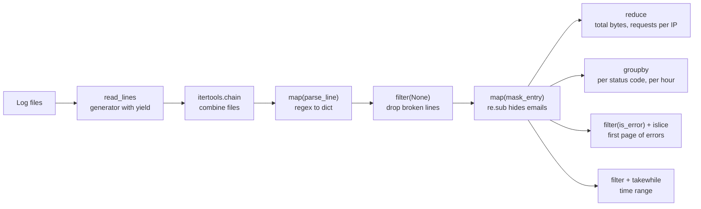

# Log File Analyzer

Parses web server access logs (Apache/Nginx Common Log Format) with regular
expressions, processes them with generators and functional programming
(`map`, `filter`, `reduce`), and prints an analytics report.

Log files are streamed one line at a time, so even very large files are
processed with almost no memory.

## Requirements

- Python 3.11+
- [Poetry](https://python-poetry.org/)

## Setup

```bash
poetry install
```

The sample logs are already in `logs/` (2 files, 1,200 lines each).
To regenerate them:

```bash
poetry run python scripts/generate_logs.py
```

## Usage

Analyze one or more log files:

```bash
poetry run python main.py logs/access_1.log logs/access_2.log
```

The report shows total requests and bytes, requests per status code and per
hour, the top 3 IP addresses, and the first 5 errors (with emails masked).
The chained `@timer` and `@log_call` decorators trace the run, and the
`@cache` statistics are printed at the end.

Run the generator vs list benchmark:

```bash
poetry run python benchmark.py
```

Run the tests:

```bash
poetry run pytest
```

## Project structure

```
src/log_analyzer/
    patterns.py     Compiled regex patterns, validation and cleaning
    parser.py       Turns one log line into a dictionary
    reader.py       Generators, chain, islice pagination, BatchIterator
    analysis.py     map / filter / reduce / partial / takewhile / groupby
    decorators.py   @timer, @log_call, @cache
    report.py       Runs the analysis and formats the report
scripts/
    generate_logs.py  Creates the sample log files
logs/               Sample access logs (1,200 lines each)
tests/              pytest test suite
main.py             CLI demo
benchmark.py        Generator vs list performance comparison
```

## Log format

Each line follows the Common Log Format:

```
192.168.1.10 - - [01/Oct/2026:13:55:36 +0000] "GET /index.html HTTP/1.1" 200 2326
```

| Part | Meaning |
|---|---|
| `192.168.1.10` | Client IP address |
| `- -` | Identity and user (usually unknown) |
| `[01/Oct/2026:13:55:36 +0000]` | Time of the request |
| `"GET /index.html HTTP/1.1"` | Method, URL and protocol |
| `200` | Status code |
| `2326` | Response size in bytes (`-` when empty) |

## Regex patterns

All patterns live in `patterns.py`. They are compiled once with
`re.compile()` when the module is imported and reused for every line.

### `LOG_PATTERN`: parsing a log line

Each field is captured with a **named group** `(?P<name>...)`, so
`match.groupdict()` turns a line straight into a dictionary.

| Pattern piece | Meaning | Matches |
|---|---|---|
| `(?P<ip>\S+) ` | Non-space characters, saved as `ip` | `192.168.1.10 ` |
| `\S+ \S+ ` | Identity and user (not saved) | `- - ` |
| `\[(?P<timestamp>[^\]]+)\] ` | Everything inside `[ ]`, saved as `timestamp` | `[01/Oct/2026:13:55:36 +0000] ` |
| `"(?P<method>[A-Z]+) ` | Capital letters after `"`, saved as `method` | `"GET ` |
| `(?P<url>\S+) ` | Non-space characters, saved as `url` | `/index.html ` |
| `(?P<protocol>[^"]+)" ` | Everything up to the closing `"` | `HTTP/1.1" ` |
| `(?P<status>\d{3}) ` | Exactly three digits | `200 ` |
| `(?P<size>\d+\|-)` | Digits, or a dash | `2326` |

The pattern is used with `match()`, which only checks from the start of the
line, so it also accepts Nginx's longer "combined" format, which adds extra
fields at the end.

### Validation and cleaning patterns

| Pattern | Regex | Used for |
|---|---|---|
| `IP_PATTERN` | `\d{1,3}\.\d{1,3}\.\d{1,3}\.\d{1,3}` | Shape of an IPv4 address. `is_valid_ip` also checks each part is 0–255, since regex cannot compare numbers. |
| `EMAIL_PATTERN` | `[\w.+-]+@[\w-]+\.[\w.-]+` | Name, `@`, domain, `.`, ending |
| `URL_PATTERN` | `https?://[\w.-]+(/\S*)?` | `http` or `https`, a domain, an optional path |
| `WHITESPACE_PATTERN` | `\s+` | Runs of spaces, tabs and newlines |

### Which `re` function is used where

| Function | Where | Purpose |
|---|---|---|
| `compile` | Every pattern | Build each pattern once and reuse it |
| `match` | `parse_line` | Does the line start like a log entry? |
| `fullmatch` | `is_valid_ip`, `is_valid_email`, `is_valid_url` | Is the whole text valid? |
| `search` | `has_email` | Is there an email anywhere in the text? |
| `findall` | `find_emails` | List every email in the text |
| `sub` | `mask_emails`, `clean_line` | Hide emails as `[EMAIL]`; collapse extra whitespace |

## Functional pipeline

Every stage takes entries in and passes entries on, so stages chain together.
All stages are lazy: nothing is read until the final step asks for results,
and then each line flows through the whole pipeline one at a time.



The same pipeline in code:

```python
lines = read_files(["logs/access_1.log", "logs/access_2.log"])
errors = filter_errors(parse_entries(lines))
print(count_by_status(errors))
```

### Techniques used

| Technique | Where | What it does |
|---|---|---|
| `map` | `parse_entries`, `mask_urls` | Transform every line or entry |
| `filter` | `parse_entries`, `filter_errors`, `filter_by_status` | Keep only matching entries |
| `functools.reduce` | `total_bytes`, `count_by_ip` | Fold all entries into one result |
| `functools.partial` | `filter_by_status`, `entries_between` | Pre-fill an argument to make a specialized filter, e.g. `partial(has_status, 404)` |
| `itertools.takewhile` | `entries_between` | Stop reading at the first entry past the end time |
| `itertools.groupby` | `count_by_status`, `count_by_hour` | Count neighbouring entries with the same key |
| `itertools.chain` | `read_files` | Read several files as one stream |
| `itertools.islice` | `paginate`, `BatchIterator` | Take a page or batch without loading the rest |
| `functools.lru_cache` | `@cache` | Remember results of repeated calls |

### Decorators

| Decorator | What it does |
|---|---|
| `@timer` | Prints how long a call took |
| `@log_call` | Prints each call with its arguments, and when it finishes |
| `@cache` | Remembers results with `functools.lru_cache` (up to 1,024) |

`analyze_logs` uses two chained decorators, `@timer` on top of `@log_call`.
`mask_emails` uses `@cache`: there are only 10 different URLs in the sample
logs, so on a full report run the regex runs 10 times and the other ~11,890
calls are answered from the cache.

## Generator vs list performance

`benchmark.py` builds a 60,000-line log and counts its valid entries in two
ways:

- **List:** read every line into a list, parse every line into another list,
  then count.
- **Generator:** stream each line through `read_lines` and `parse_entries`,
  one at a time.

| Approach | Entries | Time (s) | Peak memory |
|---|---|---|---|
| List | 59,200 | 0.67 | 41.91 MB |
| Generator | 59,200 | 0.64 | 0.02 MB |

Both give the same result in about the same time, but the generator uses
about 2,000 times less memory. The list's memory grows with the file size,
while the generator's memory stays flat however large the file is, because
only one line is in memory at any moment.

## Memory-efficient processing

- `read_lines` uses `yield`, so it reads one line at a time.
- Every pipeline stage (`map`, `filter`, `takewhile`, `islice`) is lazy.
- Generators can only be read once, so `analyze_logs` builds a fresh pipeline
  for each statistic. Reading the files several times costs some time, but it
  means all entries are never held in memory at once.
- `takewhile` and `islice` stop reading as soon as they have what they need.
  For example, the "first 5 errors" stops reading at the 5th error.

## Tests

80 pytest tests cover:

- **Regex patterns** (`test_patterns.py`): every named group, invalid lines,
  and valid/invalid IPs, emails and URLs, plus `search`, `findall` and `sub`
- **Parsing** (`test_parser.py`): typed values, and every line of both sample
  logs parsed correctly
- **Generators and iterators** (`test_reader.py`): laziness, memory size,
  `chain`, pagination and batching
- **Functional pipeline** (`test_analysis.py`): `map`, `filter`, `partial`,
  `reduce`, `takewhile` and `groupby`
- **Decorators** (`test_decorators.py`): timing, call tracing, caching and
  chaining order
- **Report** (`test_report.py`): end-to-end results on the sample logs